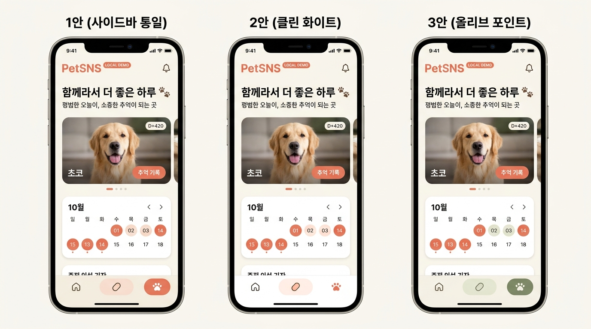
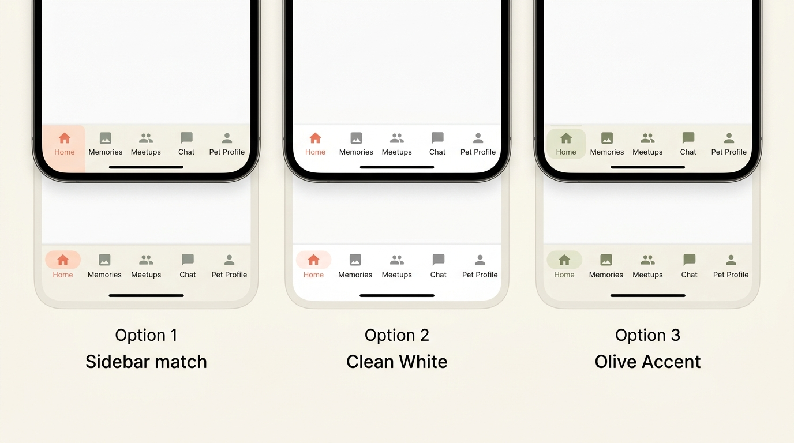
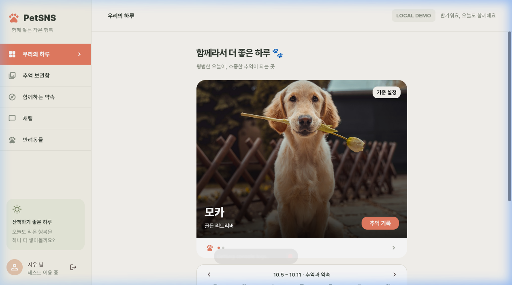

# PetSNS 공통 내비게이션 및 전역 컴포넌트 UI 색상 개선 (COMMON-UI-01)

- **작업 ID**: COMMON-UI-01
- **대상 화면**: G · 공통 구조 (웹 사이드바, 모바일 하단 내비게이션), C · 커뮤니티, H · 홈, P · 함께하는 약속
- **변경 요소**: G-02, G-05, G-06, C-05, H-06, P-07, P-09
- **작업 범위**: 모바일 하단 내비게이션 스타일 적용, 상단 경계선 추가, 사이드바 일치화, Material 3 표면 틴트 차단 및 전역 컴포넌트 테마(Card, Dialog, TabBar, SegmentedButton, Chip 등) 토큰 적용

---

## 1. 작업 목적

Flutter Material 3(`useMaterial3: true`)의 자동 생성 색상(보라·분홍 틴트)으로 인해 앱 전반의 색감이 가이드 및 디자인 시스템과 어긋나던 문제를 해결하고, 모바일 하단 내비게이션 바(4번 코랄 채움 + 상단 경계선) 및 데스크톱 사이드바, 카드, 탭, 세그먼트 버튼의 색상을 PetSNS 고유 디자인 시스템 토큰으로 일관되게 정식 반영한다.

---

## 2. 상세 변경 요구사항

### 2.1 G-05 모바일 하단 내비게이션 바
- 기존 Flutter M3 기본 자동 생성 색상(분홍·보라빛 배경 및 인디케이터) 제거.
- **4번 코랄 채움 스타일** 정식 적용:
  - 바 배경색: 따뜻한 사이드바 크림색(`AppColors.sidebar`, `#F5F2E9`).
  - 선택 탭 인디케이터(Pill): 코랄 강조색(`AppColors.primary`, `#E77D63`).
  - 선택 아이콘: 순백색(`AppColors.surface`, `#FFFFFF`).
  - 선택 라벨 텍스트: 볼드 코랄 텍스트(`AppText.captionStrong`, `#E77D63`).
  - 비활성 탭 아이콘/라벨: 세이지 그레이(`AppColors.muted`, `#899083`).
- 네비게이션 상단에 본문 캔버스와 구분되는 은은한 1px 경계선(`AppColors.sidebarBorder`, `#E7E5DB`) 추가.
- `elevation: 0`을 적용해 머티리얼 입체 그림자 및 추가 틴트 제거.
- `wide` 조건(화면 너비 950px 이하)에 맞춰 모바일에서만 노출되도록 본래 반응형 동작 유지.

### 2.2 G-02 웹 사이드바
- 데스크톱 뷰(화면 너비 950px 초과)의 좌측 사이드바 선택 타일 색상을 모바일 하단 바(4번 스타일)와 일치화.
- 선택된 메뉴 타일 배경: 코랄 강조색(`AppColors.primary`, `#E77D63`).
- 선택된 메뉴 글자 및 아이콘: 순백색(`AppColors.surface`, `#FFFFFF`).
- 미선택 메뉴 글자 및 아이콘: 기본 먹색(`AppColors.ink`, `#343D34`).

### 2.3 G-06 색상 체계 및 Material 3 표면 틴트 차단
- `ColorScheme.fromSeed(seedColor: coral)` 환경에서 컴포넌트 표면에 코랄 기반 틴트가 자동으로 덧씌워지는 현상 차단.
- `petTheme.colorScheme`에 `surfaceTint: Colors.transparent` 명시하여 전역 표면 틴트 완전 비활성화.
- `petTheme`에 전역 컴포넌트 테마(`CardThemeData`, `DialogThemeData`, `BottomSheetThemeData`, `PopupMenuThemeData` 등)를 정의하여 앱 전반의 순백색(`AppColors.surface`, `#FFFFFF`) 보장.

### 2.4 C-05 & H-06 및 전역 Card 컴포넌트
- C-05(커뮤니티 게시글 카드) 및 H-06(홈 대시보드 추억 카드)을 비롯한 전역 `Card` 위젯의 색상 일관성 확보.
- `petTheme.cardTheme`에 `color: AppColors.surface`(`#FFFFFF`), `surfaceTintColor: Colors.transparent`, `elevation: 0` 적용.
- H-04(주간 캘린더 카드) 및 대시보드 빈 프로필 카드에 누락되었던 연한 테두리(`cardBorder #E5E3DA`)를 추가해 전체 카드와 통일.

### 2.5 TabBar, SegmentedButton, Chip, Dialog 등 전역 테마
- **SegmentedButton**: 약속 카테고리(전체/강아지/고양이/기타) 및 목록/지도 전환 버튼에 M3 기본 보라빛 컨테이너 제거. 선택 시 `selected`(`#F7E3D9`) 배경 + `primary`(`#E77D63`) 글자, 미선택 시 `surface` + `cardBorder` 테두리 적용.
- **TabBar**: 커뮤니티 상단 탭의 분할선(`dividerColor`)을 `AppColors.divider`(`#E9E7DE`)로 지정하고, 코랄 인디케이터 적용.
- **Chip**: 약속 만들기 팝업의 반려견 선택 칩(`FilterChip`) 선택 시 `selected` 배경 + 코랄 체크마크, 미선택 시 `surface` + `cardBorder` 적용.
- **AppBar & Picker**: 채팅방 상단 바의 분홍 틴트 제거 및 크림 배경 일치화, 약속 날짜/시간 선택기 테마 지정.

---

## 3. 완료 기준 (Acceptance Criteria) 확인

| 항목 | 완료 기준 | 상태 | 검증 근거 |
|---|---|:---:|---|
| 1 | 모바일 하단 네비게이션에 4번 코랄 채움 스타일 적용 | ✅ 통과 | `navigationBarTheme` 및 위젯 레벨에 크림 배경(`#F5F2E9`), 코랄 필(`#E77D63`), 흰색 아이콘(`#FFFFFF`) 적용 확인 |
| 2 | 모바일 하단 네비게이션 상단에 은은한 1px 경계선 추가 | ✅ 통과 | `Container(border: Border(top: BorderSide(color: AppColors.sidebarBorder)))` 적용 확인 |
| 3 | 데스크톱 사이드바 선택 메뉴 색상이 4번 스타일과 통일 | ✅ 통과 | 사이드바 `selectedTileColor: AppColors.primary`, `selectedColor: AppColors.surface` 적용 확인 |
| 4 | M3 자동 표면 틴트(분홍·보라빛 착색) 비활성화 | ✅ 통과 | `ColorScheme.fromSeed`에 `surfaceTint: Colors.transparent` 명시 확인 |
| 5 | C-05, H-06 및 전역 카드가 틴트 없는 순백색으로 표시 | ✅ 통과 | `cardTheme`에 `color: AppColors.surface`, `surfaceTintColor: Colors.transparent` 적용 확인 |
| 6 | 주간 캘린더(H-04) 외곽선이 다른 카드와 일치 | ✅ 통과 | `home_week_calendar.dart` 컨테이너에 `Border.all(color: AppColors.cardBorder)` 적용 확인 |
| 7 | 약속 카테고리(SegmentedButton) 선택 색상 통일 | ✅ 통과 | `segmentedButtonTheme`에 살구색(`#F7E3D9`) 선택 배경 + 코랄 글자 적용 확인 |
| 8 | 커뮤니티 탭 바(TabBar) 하단 분할선이 디자인 토큰과 일치 | ✅ 통과 | `tabBarTheme`에 `dividerColor: AppColors.divider` (`#E9E7DE`) 적용 확인 |
| 9 | 반려견 선택 칩(FilterChip) 선택 색상 통일 | ✅ 통과 | `chipTheme`에 살구색(`#F7E3D9`) 배경 + 코랄 체크마크 적용 확인 |
| 10 | 채팅방 상단 바(AppBar)의 틴트 제거 및 크림 배경 통일 | ✅ 통과 | `appBarTheme`에 `backgroundColor: cream`, `surfaceTintColor: Colors.transparent` 적용 확인 |
| 11 | 임시 시안 선택 칩 및 스위처 코드가 완전히 정리됨 | ✅ 통과 | `home_screen.dart`의 `previewNavOption` 및 칩 컨테이너 완전 삭제 확인 |
| 12 | 데스크톱(950px 초과) 및 모바일(950px 이하) 반응형 정상 동작 | ✅ 통과 | 화면 너비에 따라 사이드바 ↔ 하단 바 전환 정상 동작 확인 |
| 13 | flutter analyze 및 정적 분석 통과 | ✅ 통과 | `dart-mcp-server` `analyze_files` 결과 0 errors 확인 |

---

## 4. 완료 기준 스크린샷 증적

### 4.1 실제 화면 기반 3가지 네비게이션 시안 비교

### 4.2 네비게이션 바 상세 스타일 비교 (사이드바 일치 / 화이트 / 올리브)

### 4.3 웹 사이드바 탭 구분선 및 선택 스타일 실화면 검증

