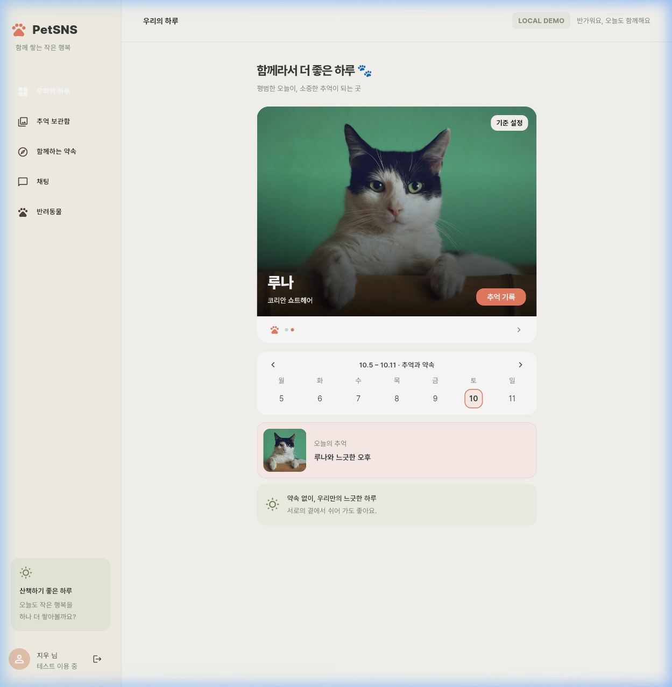
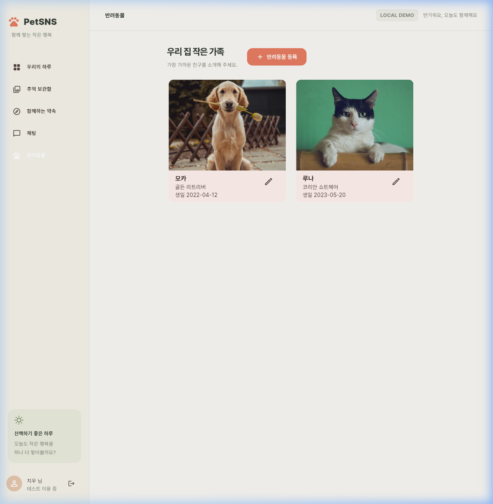
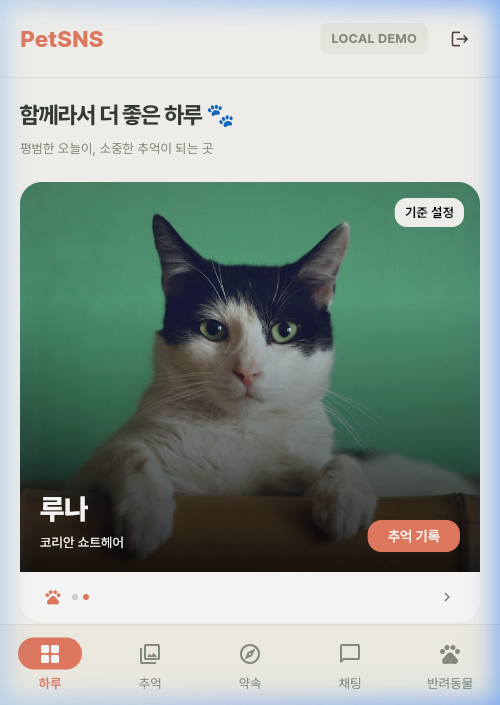
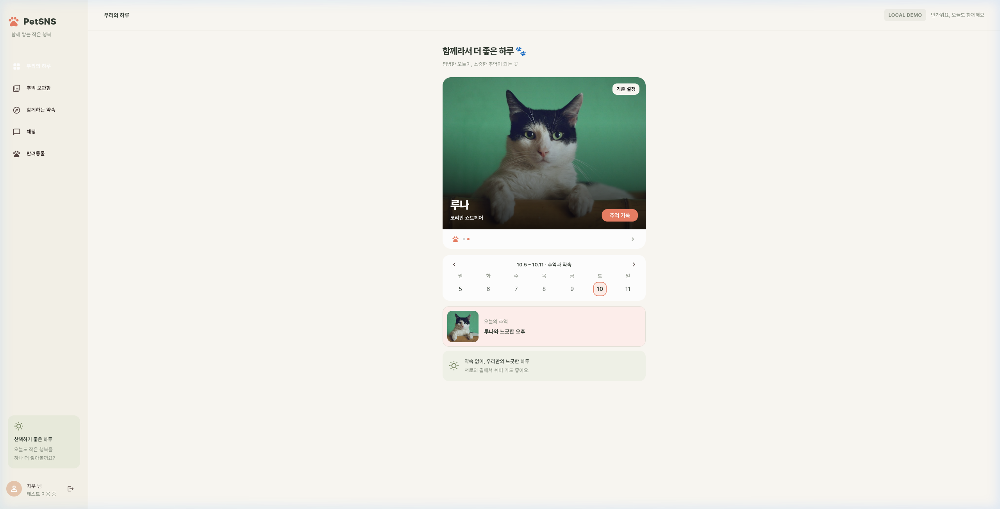

# PetSNS 홈 화면 반려동물 프로필 UI 개선 (HOME-UI-01)

- **작업 ID**: HOME-UI-01
- **대상 화면**: H · 홈 · 우리의 하루
- **변경 요소**: H-02, H-03, H-04, H-05
- **작업 범위**: UI 레이아웃 및 표시 정보 변경

---

## 1. 작업 목적

주간 달력의 Day 표시를 반려동물 사진으로 옮기고, 추억 기록 버튼 위치 변경과 사진 위에 있는 텍스트(이름, 종, 생일)에서 생일을 제거한다.

---

## 2. 상세 변경 요구사항

### 2.1 H-02 사진·가족 박스
- 기존 사진 영역과 연결된 흰색 가족 정보 박스 구조를 기준으로 수정.
- `'가족 1 / 2 마리'` 문구 제거.
- 제거한 문구 위치에 **H-05**(페이지 인디케이터 도트) 배치.
- 기존 표시되던 생일 정보는 화면에서 제거.
- 생일 데이터 자체는 삭제하지 않고 유지.

### 2.2 H-03 고정 추억 기록 버튼 & Day 표시
- 사진 우측 하단에 `'추억 기록'` 버튼 위치 수정.
- 선택된 반려동물의 기존 Day 0이 아닌 1 기준(Day 1)을 사용하여 사진 우측 상단에 `D+숫자`(예: `D+30`) 표시.
- Day 미설정 시 기존 앱의 미설정 처리 정책(`'기준 설정'`) 적용 (임의의 숫자 미표시, 탭 시 설정 창 호출).
- D+ 배지의 글자 색상은 검정색(`Colors.black`), 배경색은 앱 전체 배경색(`AppColors.canvas`, `#FAF8F3`)과 동일하게 적용.
- 추억 기록 버튼의 기존 동작(해당 반려동물의 오늘 추억 작성) 유지.

### 2.3 H-04 주간 달력
- 오늘 날짜 아래 표시되던 작은 `Day 30` 등의 Day 문구 제거.
- 기존 7일 주간 달력 구조 유지.
- 날짜 선택 기능 유지.
- 참여 약속 날짜의 노란색(`AppColors.anniversary`) 강조 표시 유지.
- 날짜 선택 시 하단 추억 및 약속 미리보기 갱신 기능 유지.
- 제거된 Day 정보는 H-03(사진 우측 상단)에서 확인 가능.

### 2.4 H-05 사진 제스처 안내
- 사진 좌우 제스처(스와이프/드래그) 기능 유지.
- 반려동물 전환 시 이름, 종, D+숫자가 함께 갱신.
- 기존 가이드의 '사진만 제스처로 이동, 프로필 글·버튼은 고정' 규칙 유지.
- 제스처 안내 문구(`'좌우로 넘겨 보세요'`) 제거, 페이지 표시(인디케이터 점)는 기존 상태 유지하되 가족 정보 박스로 이동.

---

## 3. 완료 기준 (Acceptance Criteria) 확인

| 항목 | 완료 기준 | 상태 | 검증 근거 |
|---|---|:---:|---|
| 1 | H-03 추억 기록 버튼이 사진의 우측 하단에 배치 | ✅ 통과 | 사진 배너 우측 하단 `FilledButton` 배치 확인 |
| 2 | '가족 1 / 2 마리' 문구가 제거 | ✅ 통과 | 하단 흰색 가족 박스에서 텍스트 제거 확인 |
| 3 | H-05가 안내 문구 없이 표시 | ✅ 통과 | 안내 문구 없이 페이지 인디케이터 도트만 가족 박스에 표시 확인 |
| 4 | 생일 정보는 화면에서만 제거 | ✅ 통과 | 배너에서 생일 텍스트 제거, pet 데이터의 birthday 보존 확인 |
| 5 | 사진 우측 상단에 D+숫자 표시 | ✅ 통과 | 사진 배너 우측 상단에 `D+31`, `D+2` 표시 확인 |
| 6 | 글자 색상은 검정색 | ✅ 통과 | D+ 배지 텍스트 `Colors.black` 적용 확인 |
| 7 | 배경색은 앱 전체 배경색과 동일 | ✅ 통과 | D+ 배지 배경 `AppColors.canvas` (`#FAF8F3`) 적용 확인 |
| 8 | 추억 기록 버튼의 기존 기능 유지 | ✅ 통과 | 버튼 탭 시 해당 반려동물의 추억 작성 모달 정상 호출 |
| 9 | H-04의 작은 Day 문구 제거 | ✅ 통과 | 주간 달력 날짜 아래 Day 문구 제거 확인 |
| 10 | 주간 달력의 날짜 선택과 약속 강조 정상 동작 | ✅ 통과 | 날짜 선택 시 미리보기 갱신 및 약속 날짜 노란색 강조 정상 동작 |
| 11 | 사진 좌우 제스처로 반려동물 변경 | ✅ 통과 | 드래그/스와이프로 모카 ↔ 루나 전환 정상 동작 |
| 12 | 반려동물 변경 시 이름, 종, D+숫자 갱신 | ✅ 통과 | 모카(골든 리트리버, D+31) ↔ 루나(코리안 쇼트헤어, D+2) 정상 갱신 |
| 13 | 사진, 버튼, 텍스트가 모바일/웹에서 겹치지 않음 | ✅ 통과 | 모바일(360px), 웹(1024px) 모두 레이아웃 오버랩 없음 확인 |
| 14 | flutter analyze 및 관련 test 통과 | ✅ 통과 | `analyze_files` 0 errors, 전체 78개 테스트 통과 |

---

## 4. 완료 기준 스크린샷 증적

### 4.1 모바일 화면 (반려동물 1: 모카)

### 4.2 모바일 화면 (반려동물 2 스와이프: 루나)

### 4.3 웹 화면 (넓은 뷰포트)

### 4.4 주간 달력 약속 강조 및 선택 화면

### 4.5 D+숫자 배지 및 추억 기록 버튼 (설정 완료 상태)

